<p align="center">
  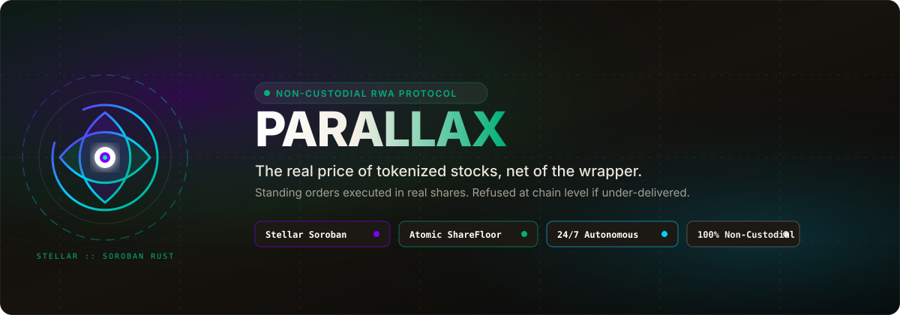
</p>

<p align="center">
  <a href="STELLAR.md"></a>
  <a href="https://github.com/parallax-protocol/parallax"></a>
  
  
  
</p>

<p align="center">
  <b>The real price of a tokenized stock, net of the wrapper.</b><br />
  <b>Powered by the Stellar Network (Soroban Rust Contracts) &amp; Multi-chain</b>
</p>

**Parallax lets investors set standing orders for tokenized US equities once, in real shares, and have them filled at any hour of the week without handing over their keys, because the blockchain itself refuses any fill that gives them fewer real shares than they signed for.**

---

## Contents

[Why this exists](#why-this-exists) · [The Weighing](#the-weighing) · [How it works](#how-it-works) · [Stellar Soroban Architecture](#stellar-soroban-architecture) · [User Interface Showcase](#user-interface-showcase) · [The Guarantee](#the-guarantee) · [Stellar RWA Assets](#stellar-rwa-assets) · [FAQ](#faq) · [Run it](#run-it) · [Repository map](#repository-map)

---

## Why this exists

A saver wants to invest in tokenized equities like Nvidia, Apple, or S&P 500 funds. They hold native stablecoins (USDC) and cannot open a traditional US brokerage account.

When buying on-chain, investors encounter four hidden traps that standard price charts conceal:

| Trap | What is actually happening |
|---|---|
| **One ticker, multiple units** | One token is not one share. Dividends, stock splits, rebases, and management fees alter the unit multiplier without a token transfer. Two tokens representing the same stock can differ significantly in real equity value. |
| **Stale reference prices** | The traditional New York Stock Exchange session covers only ~17.86% of the week, with the weekend accounting for 28.57%. Tokenized stocks continue trading 24/7 against equity reference prices that are hours or days old. |
| **Wrapper drift & spreads** | Illiquid pools cause drastic slippage, and prices can drift 5% to 20% away from true net asset values. |
| **Token-denominated limits fail** | A limit order signed as *"buy 1 token for \$120"* can deliver far fewer real shares if the underlying stock executes a split or dividend adjustment before execution. |

**Parallax solves this completely:** Limits are signed in **real shares**, not tokens. The contract checks and enforces the share floor *inside the fill transaction itself* using the live on-chain multiplier.

---

## The Weighing

<p align="center">
  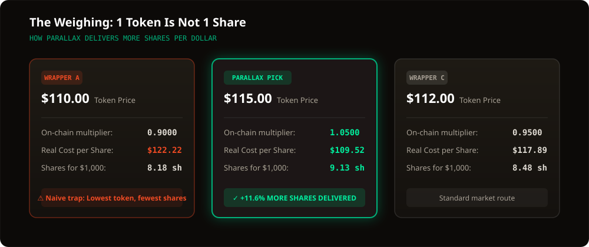
</p>

---

## How it works

1. **Connect your wallet**: Connect Freighter, xBull, or any Web3 wallet.
2. **Set a standing buy or sell order**: Specify your maximum dollar spend and your exact minimum share limit (e.g., *"Spend 100 USDC for at least 0.82 real shares of NVDA"*).
3. **Close the tab**: Parallax is 100% non-custodial. Your funds remain in your wallet. An automated Keeper monitors liquidity across DEX venues (Soroswap, Phoenix AMM, SDEX) 24/7.
4. **On-chain enforcement**: When liquidity matches your target, the Keeper executes `fill()`. The contract queries the issuer's live on-chain multiplier in that exact transaction.
   - If $\text{shares\_out} \ge \text{order.min\_shares}$: Tokens are delivered directly to your wallet.
   - If $\text{shares\_out} < \text{order.min\_shares}$: The transaction panics/reverts atomically.

---

## Stellar Soroban Architecture

On Stellar, Parallax is built with native Rust smart contracts using the `soroban-sdk`:

<p align="center">
  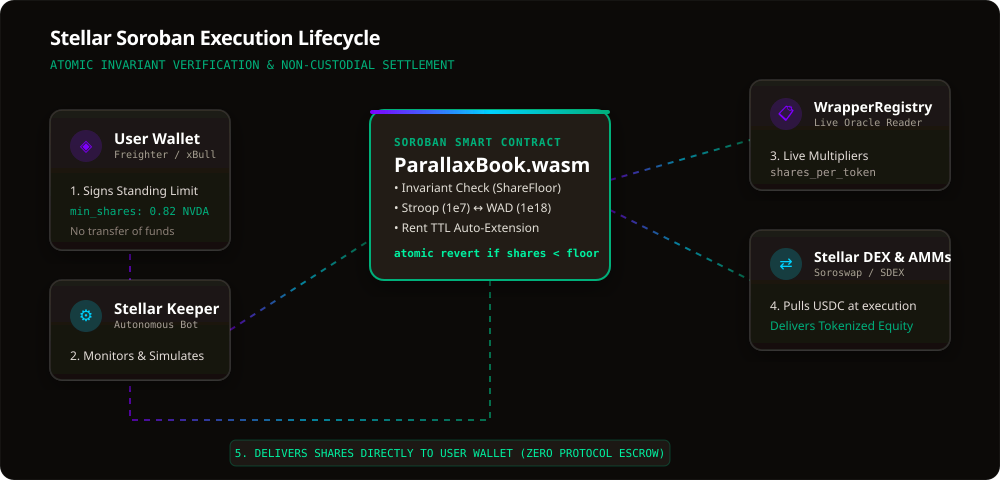
</p>

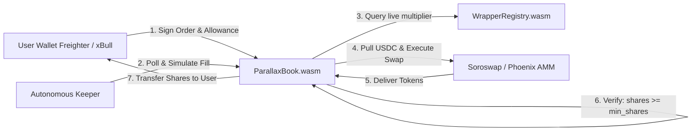

### Key Soroban Contracts (`contracts/soroban/`)
* **`ParallaxBook`** (`src/book.rs`):
  * Standing limit order book for tokenized equities.
  * Native Circle USDC settlement (7 decimals) normalized to 18-decimal equity share units (`WAD`).
  * Automated Soroban persistent storage TTL rent extension.
* **`WrapperRegistry`** (`src/registry.rs`):
  * Active wrapper registry per equity ticker.
  * Real-time on-chain unit readers (`shares_per_token`) and pause checks (`is_paused`).

Full details are documented in [`STELLAR.md`](STELLAR.md).

---

## User Interface Showcase

The Parallax web application provides an institutional-grade, responsive interface for non-custodial trading, real-time weighing, and formal verification.

<p align="center">
  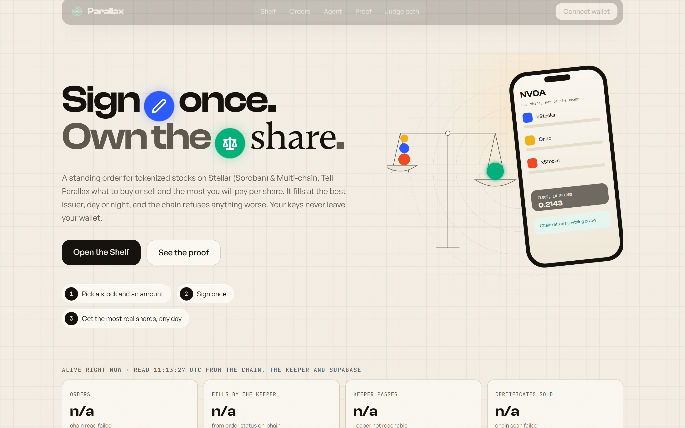
</p>

<table width="100%">
  <tr>
    <td width="50%" align="center">
      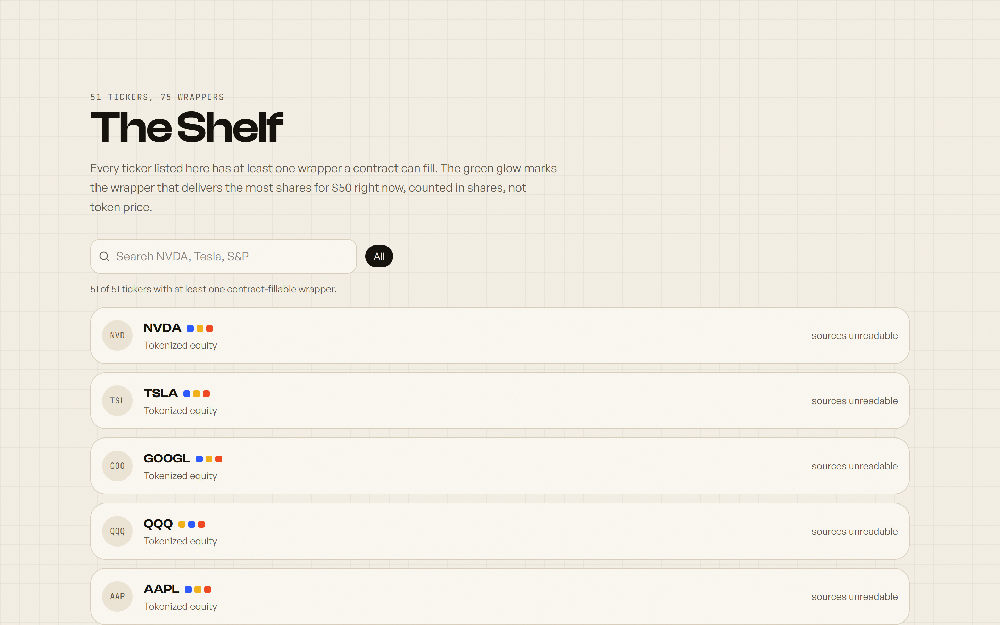
      <br />
      <b>The Shelf.</b> Real-time equity pricing across all registered issuers, weighed in real shares rather than raw token prices.
    </td>
    <td width="50%" align="center">
      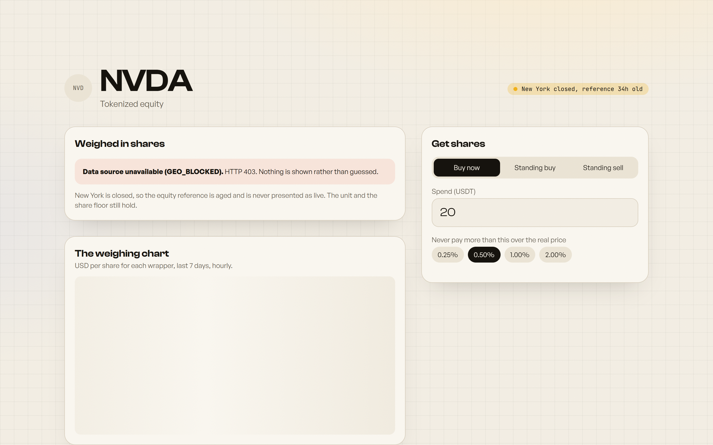
      <br />
      <b>The Weighing &amp; Trade Panel.</b> Three wrappers, one share. The green indicator highlights the issuer delivering the highest shares per dollar.
    </td>
  </tr>
  <tr>
    <td width="50%" align="center">
      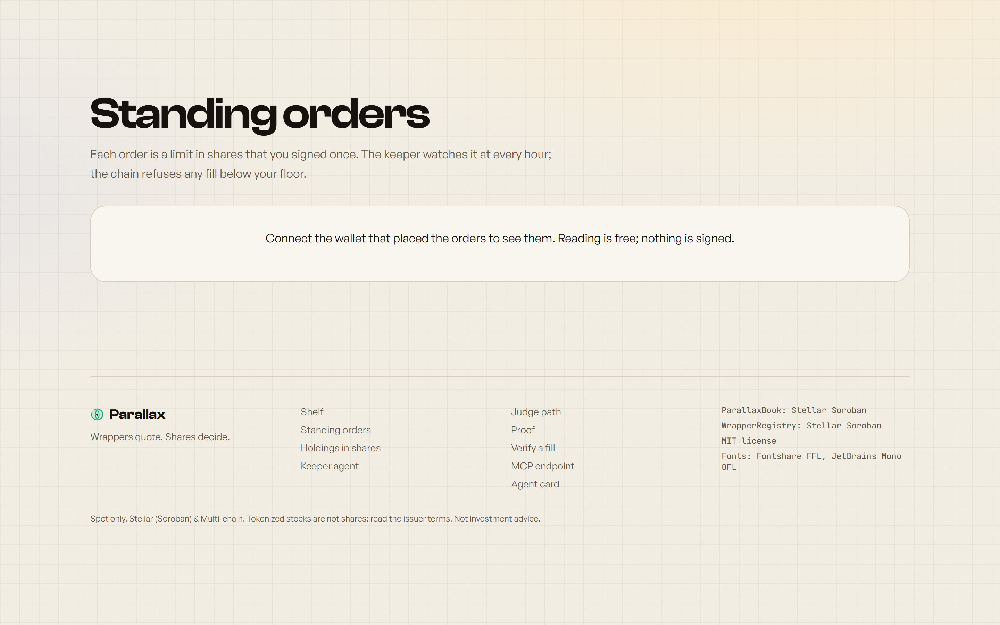
      <br />
      <b>Standing Limit Orders.</b> Limit orders signed in shares, verified atomically on-chain. Zero protocol escrow; funds remain in your wallet.
    </td>
    <td width="50%" align="center">
      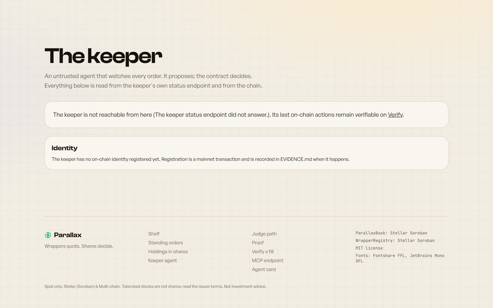
      <br />
      <b>Autonomous Keeper Agent.</b> Real-time pass, fill, and typed refusal journal read directly from the keeper endpoint and blockchain events.
    </td>
  </tr>
  <tr>
    <td width="50%" align="center">
      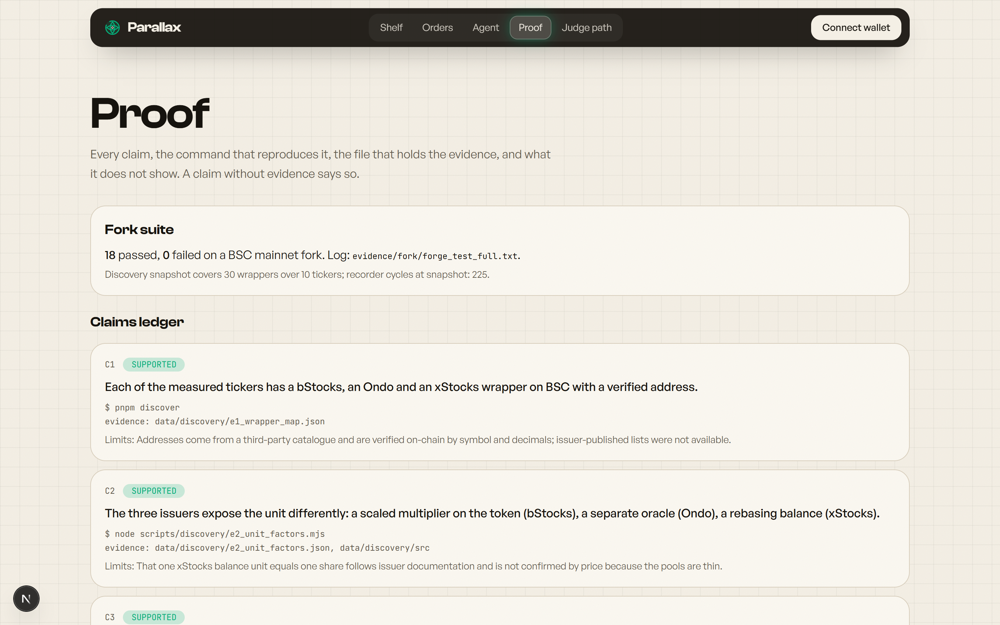
      <br />
      <b>Proof &amp; Invariants Ledger.</b> Machine-verifiable claims matrix with test reproduction commands, invariants (T1–T12), and limitations.
    </td>
    <td width="50%" align="center">
      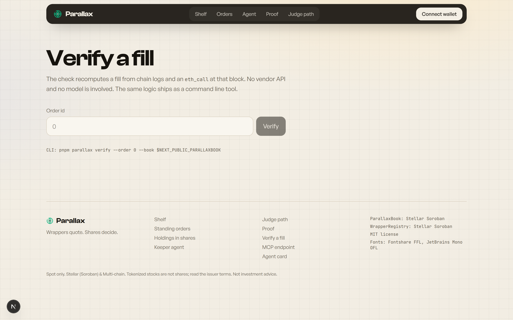
      <br />
      <b>Offline Verifier.</b> Recomputes fills from raw chain logs and block state with zero vendor API reliance and no AI hallucination.
    </td>
  </tr>
</table>

### Mobile Responsive Interface

<p align="center">
  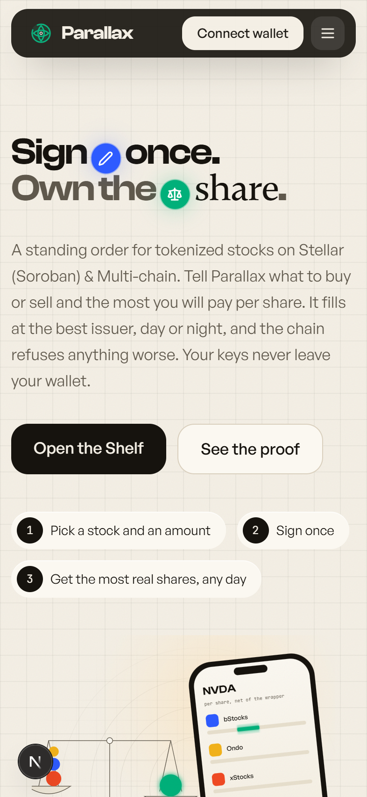
  &nbsp;&nbsp;
  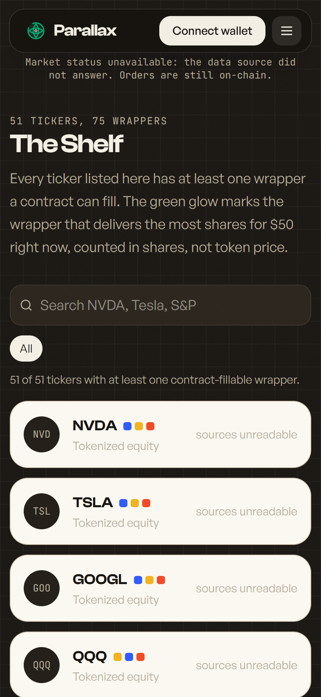
  &nbsp;&nbsp;
  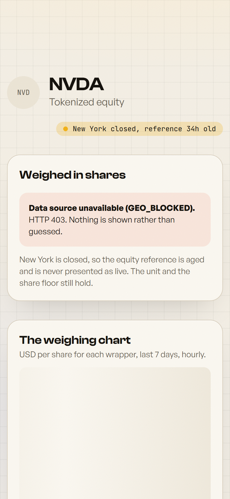
</p>

---

## The Guarantee

**The Share Floor Invariant**:  
A fill transaction never delivers fewer share-equivalents than `order.minShares`. 

$$\text{shares\_delivered} = \frac{\text{tokens\_received} \times \text{live\_multiplier}}{10^{18}}$$

If $\text{shares\_delivered} < \text{order.minShares}$, the transaction reverts immediately. Neither a malicious keeper nor a routing malfunction can ever force an under-delivering fill.

---

## Stellar RWA Assets

Parallax supports institutional and tokenized equity assets on Stellar:
* **Franklin Templeton BENJI (FOBXX)**: The first US-registered mutual fund on a public blockchain.
* **Backed Finance Equity Tokens**: Bridged and native equity tokens (`bNVDA`, `bAAPL`, `bTSLA`, `bSPY`).
* **Ondo Finance & WisdomTree**: Tokenized treasury and equity instruments.
* **Native Circle USDC**: Fast, low-fee dollar settlement with ~3-5 second finality.

---

## FAQ

**Does Parallax take custody?**  
No. Your funds remain in your wallet until the exact transaction where the order fills. Parallax holds nothing between transactions.

**What if the keeper goes offline or acts maliciously?**  
A malicious keeper cannot bypass the on-chain share floor. An offline keeper simply means the order waits; you can cancel your order at any time without fees.

**Why not compare raw token prices?**  
Because 1 token is rarely 1 share. A token priced at \$110 might represent 0.9 shares, while a token priced at \$115 might represent 1.05 shares. The \$115 token is actually cheaper per real share!

**How are stock splits and dividends handled?**  
The issuer adjusts the multiplier on-chain. Because Parallax checks the multiplier at the instant of execution, an order signed in real shares automatically inherits the correct equity backing.

---

## Run it

### 1. Install Dependencies
```bash
pnpm install
```

### 2. Run the Web Application
```bash
pnpm dev
# Local app runs at http://localhost:3000
```

### 3. Build & Test Stellar Soroban Contracts
```bash
cd contracts/soroban
cargo build --target wasm32-unknown-unknown --release
cargo test
```

### 4. Run the Stellar Keeper Bot
```bash
pnpm run keeper:stellar
```

---

## Repository Map

```
contracts/
  soroban/     Stellar Soroban Rust contracts (ParallaxBook, WrapperRegistry, tests)
  src/         EVM smart contracts (ParallaxBook.sol, WrapperRegistry.sol)
packages/
  kernel/      Unit-safe fixed-point math, Stellar stroop conversions, session clock
  registry/    Stellar network configuration, SAC addresses, wrapper catalog
  binance/     Market data clients
  verify/      Offline verifier CLI
services/
  keeper/      Stellar Soroban keeper engine, quote evaluator, event recorder
apps/
  web/         Next.js Web application, trade panel, analytics, MCP routes
skills/
  parallax/    Autonomous Agent wallet skill
docs/          Architectural guides, decisions ledger, visual marks & QA screenshots
```

---

## License

MIT License. Copyright (c) 2026 Parallax Protocol.
